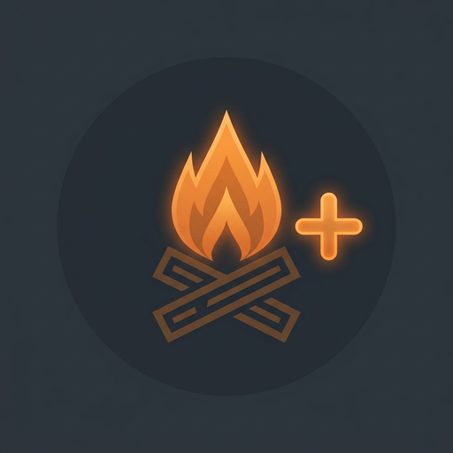

# Campfire+

  

A realistic campfire overhaul for Minecraft 1.21.1 (NeoForge). Campfires now burn out over time, require fuel management, interact dynamically with weather, and integrate with survival mods.

## 🔥 Features

- **Fuel & Burn Out Mechanics**:
  - Campfires slowly consume their logs as fuel.
  - Logs burn down stage-by-stage into glowing embers, and eventually into cold charred logs.
  - Fuel maintenance: right-click with logs to replace embers or charred logs and keep the fire going.
  - Salvaging: Breaking a campfire drops unburnt logs according to its remaining fuel state.

- **🌧️ Weather & Environmental Interactions**:
  - Direct rain and storm exposure will douse unprotected campfires.
  - Full compatibility with **Simple Clouds** localized rainfall and storm tracking.

- **🌡️ Mod Compatibility**:
  - **Cold Sweat**: Seamless temperature integration where campfires provide warmth based on flame level and ember heat.
  - **Jade**: Full tooltip integration showing burn time remaining, log count, ember stages, lighting progress, and burnt status.

## 📜 Credits & License

- Licensed under MIT.
- Ember and burnt log models & textures adapted from *Burnt Basic* by Pixelbank (MIT License).
